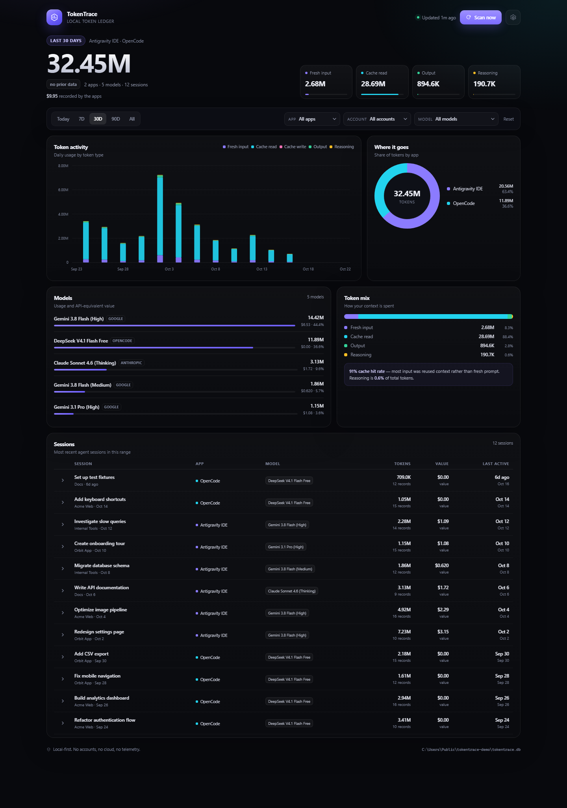

# TokenTrace

TokenTrace is a local-first token ledger for AI coding apps. It reads the usage
data that OpenCode, Antigravity, Claude Code, Codex and Gemini CLI already keep
on disk, normalizes it into one SQLite database, and shows a single dashboard
for every app, surface and local account.

No login, no telemetry, no cloud database, and no Node/npm dependencies. The
server binds to loopback only by default, and everything lives under
`~/.tokentrace/`.



*Screenshot uses synthetic demo data.*

```
TokenTrace
├─ one event per model response
├─ input / cache read / cache write / output / reasoning
├─ app, surface, local account label, session, project and model
├─ exact cost when an app records it, otherwise API-equivalent estimate
└─ local dashboard + terminal report + CSV/JSON export
```

## Quick start

Requirements: Python 3.10+ (tested with Python 3.12 on Windows). No third-party
packages.

Clone the repo (or download the ZIP and extract it), then start the app from
the project folder.

On Windows, double-click:

```text
TokenTrace.cmd
```

Or from a terminal on any platform:

```powershell
python tokentrace.py
```

On macOS or Linux, use `python3 tokentrace.py` if `python` is not available.

The first run scans the supported apps, starts a local server, and opens:

```text
http://127.0.0.1:8787/
```

The server automatically picks the next free port if 8787 is busy. Keep the
terminal window open while the dashboard is running. Press `Ctrl+C` to stop it.

The dashboard refreshes every 30 seconds and rescans in the background every
two minutes (configurable).

## What is supported

| App | Data read | Notes |
| --- | --- | --- |
| OpenCode | `~/.local/share/opencode/*.db` | Per-message token breakdown; per-message exact cost when present |
| Antigravity | `~/.gemini/antigravity*/conversations/*.db` | App, IDE and CLI surfaces; retries deduplicated by response ID |
| Claude Code | `~/.claude/projects/**/*.jsonl` | Account email detected when present in `.claude.json` |
| Codex | `~/.codex/sessions/**/*.jsonl` | Reads token-count events; supports archived sessions |
| Gemini CLI | `~/.gemini/tmp/*/chats/*.json` | Reads per-message token records |

Additional folders can be added with `extra_paths` in the config, for example a
second drive, a backup folder, or a portable install.

TokenTrace only supports apps that expose token counts locally. It does not
scrape web chat UIs or use hidden APIs.

## Commands

```powershell
# Scan all sources and update the database
python tokentrace.py scan

# Start the dashboard (default command)
python tokentrace.py
python tokentrace.py serve --port 8787 --no-open

# Terminal report
python tokentrace.py report --days 30
python tokentrace.py report --days 0      # all time

# Diagnose discovery and database state
python tokentrace.py doctor

# Export raw events
python tokentrace.py export --days 30 --out tokentrace-export.csv
python tokentrace.py export --days 0 --out tokentrace-export.json --format json
```

Useful `serve` options:

```text
--port 8787          preferred port
--host 127.0.0.1     bind address; keep loopback for privacy
--no-open            do not open a browser
--no-scan            skip the startup scan (background scans still run)
--interval 120       background scan interval in seconds; 0 disables it
--verbose            log HTTP requests
```

## Dashboard

- Range: today, 7 days, 30 days, 90 days or all time.
- Filter by app, local account label and model. Filters combine.
- Daily stacked chart, app donut, model usage, and token mix.
- Session table with expandable token and model details.
- `Scan now` updates immediately.
- Settings lets you rename local accounts. Labels are stored in
  `~/.tokentrace/config.json`, not in the source apps.

### Accounts

Most AI apps do not store an account email next to their usage records. TokenTrace
therefore treats each app surface as a local account and lets you label it:

- `antigravity` — Antigravity App
- `antigravity-ide` — Antigravity IDE
- `antigravity-cli` — Antigravity CLI
- `opencode` — OpenCode CLI
- `opencode-preview` — OpenCode Preview
- `claude_code` or a detected email — Claude Code
- `codex` — Codex CLI
- `gemini_cli` — Gemini CLI

Claude Code account detection uses the email in `~/.claude.json` or
`~/.config/claude/claude.json` when available. Other apps do not expose a login
identity in their local token records, so two logins in the same installation
cannot be split retroactively.

## Configuration

The config is created at `~/.tokentrace/config.json`:

```json
{
  "accounts": {
    "antigravity-ide": "Antigravity IDE",
    "opencode": "OpenCode"
  },
  "extra_paths": {
    "antigravity": [],
    "opencode": [],
    "claude_code": [],
    "codex": [],
    "gemini_cli": []
  },
  "pricing": {},
  "scan_interval_seconds": 120
}
```

### Extra paths

Each value is a list of folders (or one string). TokenTrace searches them in
addition to the default locations.

```json
{
  "extra_paths": {
    "opencode": ["D:\\Backups\\opencode"],
    "antigravity": ["D:\\Backups\\antigravity\\conversations"],
    "claude_code": ["D:\\Archive\\claude-projects"],
    "codex": ["D:\\Archive\\codex-sessions"],
    "gemini_cli": ["D:\\Archive\\gemini\\tmp"]
  }
}
```

Paths are scanned recursively where that source uses recursive discovery
(Claude Code, Codex and Gemini CLI). OpenCode and Antigravity look for `*.db`
files in the given folder.

### Pricing overrides

Prices are USD per one million tokens. An override can be keyed by model name
or by `provider/model`:

```json
{
  "pricing": {
    "gemini-3.8-flash-high": {
      "input": 0.75,
      "output": 3.75,
      "cache_read": 0.075,
      "cache_write": 0,
      "reasoning": 3.75
    },
    "my-provider/my-custom-model": {
      "input": 1.0,
      "output": 4.0
    }
  }
}
```

OpenCode's recorded per-message cost always wins over estimates. Antigravity,
Claude Code, Codex and Gemini CLI costs are API-equivalent list-price estimates,
not subscription charges. A model with no known price is shown as `n/a` and
excluded from the value total.

### Custom data directory

Set `TOKENTRACE_HOME` to keep the database and config somewhere else:

```powershell
$env:TOKENTRACE_HOME = "D:\TokenTraceData"
python tokentrace.py
```

## Data model

TokenTrace stores one normalized row per model response in SQLite:

```text
events
  id, source, source_label, surface, account_key
  session_id, session_title, project
  model, model_label, ts
  input, output, reasoning, cache_read, cache_write
  cost, cost_kind, price_provider, ref
```

`cost_kind` is `exact` when the source recorded a cost, `estimated` when a public
price was applied, and `unknown` when no price could be found.

Event IDs are deterministic hashes of source, account, session and native
response ID. Re-scans therefore update rows instead of duplicating them.
Antigravity retry records are collapsed using their response ID before insert.

## How it was validated

- OpenCode session totals were compared against its own `session_v2` ledger.
- Antigravity's protobuf usage records were checked against conversation DB row
  counts, and retry records were confirmed to duplicate primary usage.
- The Antigravity layout follows the proven ccusage interpretation:
  model ID, input, total output, cache write, cache read, reasoning and visible
  output.
- The dashboard and the terminal report read from the same aggregation query.

## Project layout

```text
tokentrace.py                 CLI entry point
TokenTrace.cmd                Windows double-click launcher
tt/config.py                  config, paths and account labels
tt/db.py                      SQLite schema and event upserts
tt/scan.py                    discovery, pricing and scan orchestration
tt/query.py                   dashboard/report aggregation
tt/server.py                  stdlib loopback HTTP server
tt/pricing.py                 models.dev cache, fallbacks and overrides
tt/adapters/                  one adapter per supported app
tt/web/dashboard.html         single-file offline dashboard
```

To add another source, implement `discover(extra_paths)` and `scan(instance)` in
a new adapter module, return `Instance` and `Event` objects from
`tt/adapters/base.py`, then register the module in `tt/adapters/__init__.py`.
No web build step is required.

## Privacy and security

- Reads source databases read-only where supported.
- Writes only to `~/.tokentrace/` (or `TOKENTRACE_HOME`).
- Dashboard binds to `127.0.0.1` by default.
- POST endpoints require a random per-process token embedded in the page.
- No analytics, remote fonts, CDNs or outbound network requests.
- Session titles and project names are part of the local database; delete
  `~/.tokentrace/tokentrace.db` to clear the ledger.

## Limitations

- Costs for subscription products are estimates of API-equivalent usage, not
  amounts billed by the vendor.
- An app that does not write token counts to disk cannot be tracked locally.
- Two logins in the same app installation share one local account key unless the
  app itself separates their data folders.
- Antigravity's DB format is unofficial and may change in a future release.
- Deleted source history stays in the TokenTrace database until you remove the
  database.
- This is a V1: there is no Windows service, auto-start task, or cloud sync.

## License

MIT. See [LICENSE](LICENSE).

## Credits

The adapter design and Antigravity decoding were informed by prior art in
[ccusage](https://github.com/ryoppippi/ccusage) and
[openusage](https://github.com/robinebers/openusage). TokenTrace is an
independent, standard-library-only implementation.
